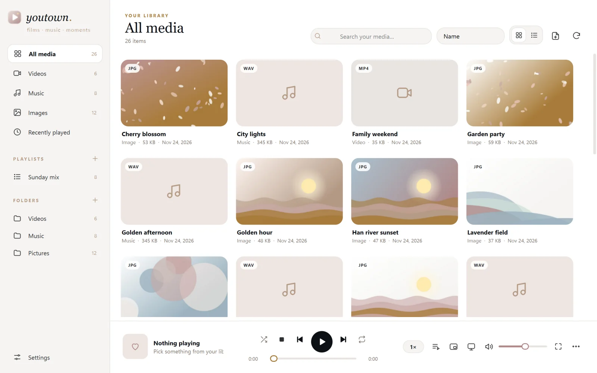
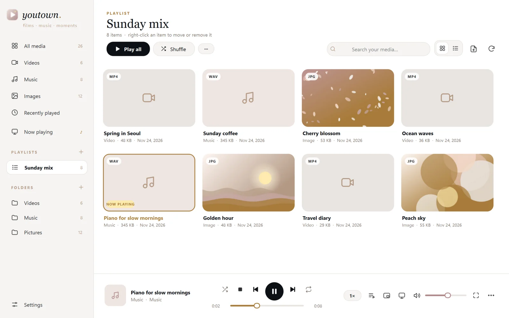
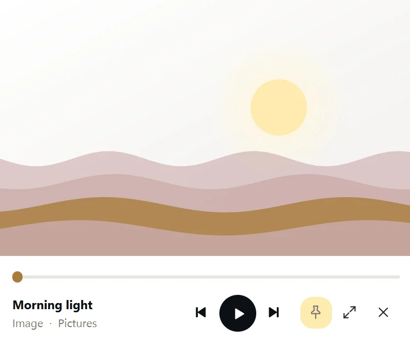
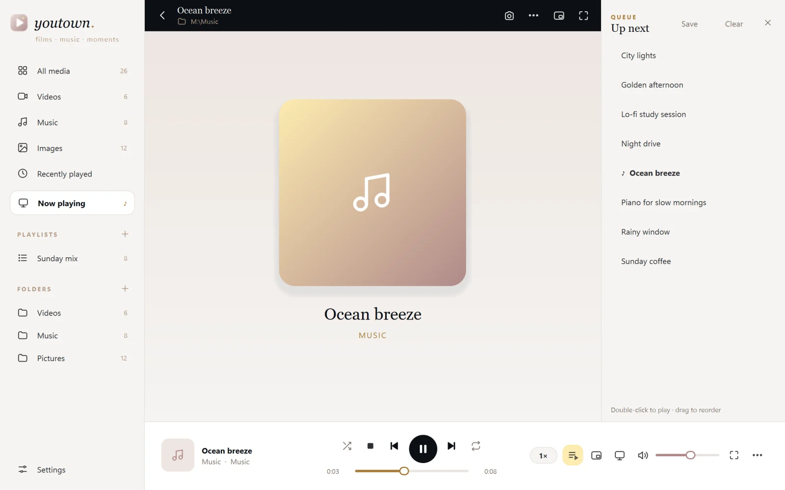

<p align="center">
  
</p>

<h1 align="center">YouTown Player</h1>

<p align="center">
  A calm, lightweight media player for Windows. It finds all your videos, music and photos,<br>
  plays every format VLC plays, and keeps a mini player on top while you work.
</p>

<p align="center">
  <a href="../../releases/latest"><b>⬇ Download for Windows</b></a> ·
  <a href="#features">Features</a> ·
  <a href="#build-from-source">Build from source</a>
</p>

<p align="center">
  
</p>

## Features

- **Your whole library**: scans Videos, Music, Pictures, Downloads and Desktop (or any folder you add), with
  Windows thumbnails, instant search, sorting, and grid or list views.
- **Plays everything VLC plays**: MKV, MP4, AVI, MOV, WMV, FLV, M2TS, VOB, WebM… MP3, FLAC, WAV, AAC, OGG, Opus,
  WMA, APE, MIDI… plus playlists, ISO files and network streams. More than 150 file types, powered by libVLC.
- **Mini player**: a small rounded window that stays above all apps. Drag it anywhere and resize it from the edges.
- **Floating preview**: leave a video and it keeps playing in a corner card while you browse.
- **Playlists**: mix videos, songs and photos. Reorder, shuffle, and import or export `.m3u`, `.pls` and `.xspf`.
- **Pro controls**: speed 0.25×–4×, A→B loop, frame-by-frame, audio and subtitle tracks, external subtitles,
  audio and subtitle delay, equalizer, aspect ratio, snapshots, fullscreen, always on top, and resume where you left off.
- **Plays in the background**: taskbar thumbnail buttons, media keys, tray icon, and optional close-to-tray.
- **VLC keyboard shortcuts**, so it feels familiar from day one.
- **Default app**: register it from Settings, then choose it in Windows Default apps.
- **See where files live**: real paths, one click to File Explorer, and Windows file Properties.

| Playlists | Mini player | Music |
|---|---|---|
|  |  |  |

## Install

Download **YouTown-Player-Setup.exe** from the [latest release](../../releases/latest) and run it.
It installs for your user only (no admin rights needed) and includes its own copy of libVLC, so VLC doesn't
need to be installed.

> The installer isn't code-signed yet. If Windows SmartScreen says *"Windows protected your PC"*,
> click **More info → Run anyway**.

## Build from source

Requirements: Windows 10/11 (64-bit), Python 3.12+, and [VLC 64-bit](https://www.videolan.org/vlc/)
(used while developing and bundled into the build). [NSIS](https://nsis.sourceforge.io/) is needed for the installer.

```powershell
python -m venv .venv
.venv\Scripts\pip install -r requirements.txt
.venv\Scripts\python run.py                 # run from source
.venv\Scripts\python packaging\build.py     # builds dist\YouTown Player\ and dist\YouTown-Player-Setup.exe
```

### Project layout

```
run.py                  entry point
youtown/
  window.py             main window: library, player, playlists, settings
  engine.py             libVLC playback engine
  mini.py               always-on-top mini player
  preview.py            floating video preview over the library
  library.py            fast folder scanner + playlist file parsing
  playlists.py          user playlists (JSON)
  thumbs.py             Windows shell thumbnails with disk cache
  winintegration.py     Default apps, media keys, taskbar buttons
  theme.py              palette, stylesheet, icons
packaging/              PyInstaller spec, NSIS installer, build script
docs/                   landing page (GitHub Pages)
```

## License

YouTown Player is released under the [MIT License](LICENSE). The installer bundles libVLC and Qt, which keep
their own LGPL licenses; see [THIRD-PARTY-NOTICES.md](THIRD-PARTY-NOTICES.md).

## Credits

Playback by [libVLC](https://www.videolan.org/vlc/libvlc.html) (LGPL 2.1+). UI built with
[Qt for Python / PySide6](https://doc.qt.io/qtforpython/) (LGPL 3). YouTown Player isn't affiliated with VideoLAN.
